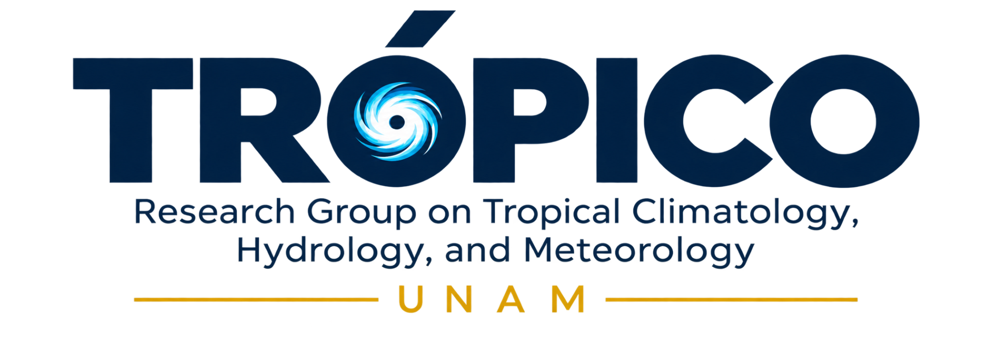

  

# Tropical Weather & Climate Observatory

**Explore tropical weather, precipitation, and climate conditions across the Americas.**

[**Explore the Tropical Observatory**](https://tropicoresearch.github.io/tropical-observatory/)

Tropical Weather & Climate Observatory (TWCO) is a scientific monitoring and visualization platform developed by **Alejandro Jaramillo-Moreno**, Research Scientist at the Instituto de Ciencias de la Atmósfera y Cambio Climático (ICAyCC), Universidad Nacional Autónoma de México (UNAM), and one of the lead researchers of **TRÓPICO — Research Group on Tropical Climatology, Hydrology, and Meteorology**.

The observatory provides regularly updated maps of tropical precipitation, atmospheric conditions, sea surface temperature, and outgoing longwave radiation (OLR), combining satellite observations, climate datasets, and numerical weather prediction products.

The platform integrates **NASA GPM IMERG, NOAA datasets, GFS, and ECMWF IFS**, with regional visualizations covering the global tropics, the Americas, Mexico, and Colombia. The observatory is updated automatically four times daily (UTC), with the latest available scientific products published as new data become available.

Information about the observational products, data sources, and scientific interpretation is available directly on the [observatory website](https://tropicoresearch.github.io/tropical-observatory/).

---

## Creator and Maintainer

<table>
  <tr>
    <td width="160" align="center" valign="middle">
      
    </td>
    <td valign="middle">
      <strong>Alejandro Jaramillo-Moreno</strong> 
      Research Scientist 
      Instituto de Ciencias de la Atmósfera y Cambio Climático (ICAyCC) 
      Universidad Nacional Autónoma de México (UNAM) 
      One of the lead researchers of TRÓPICO  
      <a href="https://ajaramillomoreno.github.io/">Personal Website</a>
    </td>
  </tr>
</table>

---

### Disclaimer

Tropical Weather & Climate Observatory is an independent scientific visualization and outreach initiative. It is not an official operational product of NOAA or UNAM. Its products are intended for scientific exploration, education, and public communication, not for issuing official weather forecasts or hazard warnings.
